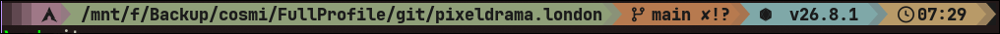

# protanomaly-starship

A [Starship](https://starship.rs) prompt configuration in the PixelDrama
ProtAnomaly palette, a protanomaly-calibrated color theme. It's a companion
to the [pixeldrama-protanomaly-nvim](https://github.com/cosminoance/pixeldrama-protanomaly-nvim)
colorscheme, sharing the same palette so the editor and the shell prompt
read as one consistent theme.



## Requires

A [Nerd Font](https://www.nerdfonts.com/) in your terminal, for the icon
glyphs used throughout `starship.toml`. The sibling configs in this theme
use [JetBrainsMono Nerd Font](https://www.nerdfonts.com/font-downloads).

## Install

Back up your existing config first, then copy `starship.toml` to
`~/.config/starship.toml` (or wherever your `$STARSHIP_CONFIG` points):

```sh
cp ~/.config/starship.toml ~/.config/starship.toml.old
cp starship.toml ~/.config/starship.toml
```

## Palette

Colors live under `[palettes.warm_accessible]` in `starship.toml`:

- `p_start` — muted dusty rose
- `p_mid` — muted sage
- `p_end` — muted warm orange
- `p_cyan` — muted blue-green
- `p_amber` — muted warm amber
- `p_bg_dark` — neutral near-black
- `p_fg` — warm light foreground

## Extending

Add or edit module sections directly in `starship.toml` — see the
[Starship config docs](https://starship.rs/config/) for the full list of
modules and options. To keep a new module in theme, style it with one of
the palette keys above rather than a hardcoded color.
